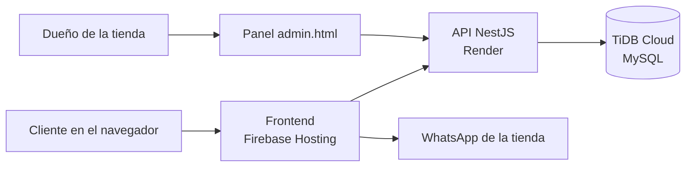

# El Mejenguero CR

Tienda en línea de camisetas de fútbol en Costa Rica. Vende camisetas de selecciones, clubes europeos, equipos nacionales y ediciones retro, en versión Fan y Player. El cliente arma su carrito y el pedido llega a la tienda por WhatsApp.

El proyecto tiene dos partes que viven en este mismo repositorio:

- **Frontend:** sitio estático en HTML, JavaScript y Tailwind CSS, publicado en Firebase Hosting.
- **Backend:** API en NestJS con base de datos MySQL (TiDB Cloud) y login de administrador con JWT. Su documentación propia está en **[`backend/README.md`](backend/README.md)**.

## Proyecto en vivo

**[el-mejenguero-cr.web.app](https://el-mejenguero-cr.web.app/)**

El sitio publicado solo cambia cuando los cambios se fusionan en `main` y se vuelven a publicar con Firebase. El backend está publicado en Render y la base de datos en TiDB Cloud.

## Estado del proyecto

| Parte | Estado |
|---|---|
| Tienda: inicio, catálogo, detalle, carrito y pedido por WhatsApp | ✅ Listo |
| API de camisetas con base de datos | ✅ Listo |
| Login de administrador y protección de las operaciones de escritura | ✅ Listo |
| Frontend leyendo el catálogo desde la API | ✅ Listo |
| Panel del administrador (`admin.html`) | ✅ Listo |
| Publicación del backend | ✅ Listo (Render) |

## Arquitectura



- Los clientes **leen** el catálogo sin iniciar sesión.
- Solo el administrador puede **crear, editar o eliminar** camisetas, con un token que obtiene al iniciar sesión.
- Las fotos están en `img/productos/` y la base de datos solo guarda su ruta.

## Funciones de la tienda

- **Catálogo con filtros y búsqueda:** por categoría (Nacionales, Selecciones, Clubes y Retro) y por texto, sin importar tildes, mayúsculas ni espacios de más. Los filtros quedan en la URL (`?categoria=` y `?q=`), así que el enlace se puede compartir. Incluye un botón "Limpiar filtros".
- **Destacados:** el inicio muestra las camisetas marcadas como `destacado`. Si ninguna lo está, muestra las primeras cuatro.
- **Detalle de producto:** `producto.html?id=` muestra tallas, versión Player y disponibilidad.
- **Disponibilidad:** una camiseta con `disponible: false` aparece como "Agotada" y no se puede comprar. Sin tallas, el botón dice "Tallas pendientes".
- **Carrito:** por talla, con un máximo de 10 unidades por talla. Se guarda en el navegador (`localStorage`) y se valida al cargar: el precio, el nombre y la imagen se toman siempre del catálogo, y se descartan productos agotados, inexistentes o con tallas que ya no se venden.
- **Pedido por WhatsApp:** pide nombre, cédula (9 dígitos) y teléfono (8 dígitos), y arma un mensaje con el detalle del pedido para el WhatsApp de la tienda.
- **Responsivo y accesible:** funciona en celular, tablet y computadora. El menú, el carrito y el formulario se cierran con `Esc` o con clic afuera, y están marcados como diálogos para lectores de pantalla.

## API del backend

> Detalles de instalación, estructura y pruebas del servidor en **[`backend/README.md`](backend/README.md)**.

- En producción: `https://el-mejenguero-cr-website.onrender.com`
- En local: `http://localhost:3000`

| Método | Ruta | Acceso | Qué hace |
|---|---|---|---|
| `GET` | `/camisetas` | Público | Lista todas las camisetas |
| `GET` | `/camisetas/:id` | Público | Devuelve una camiseta (404 si no existe) |
| `POST` | `/auth/login` | Público | Recibe `usuario` y `contrasena`; devuelve `access_token` |
| `POST` | `/camisetas` | 🔒 Administrador | Crea una camiseta |
| `PATCH` | `/camisetas/:id` | 🔒 Administrador | Modifica solo los campos enviados |
| `DELETE` | `/camisetas/:id` | 🔒 Administrador | Elimina una camiseta |

Las rutas 🔒 necesitan el encabezado `Authorization: Bearer <access_token>`. Sin token, o con un token alterado o vencido, responden **401**. Los datos inválidos responden **400**.

**Ejemplo de login:**

```json
POST /auth/login
{
  "usuario": "admin",
  "contrasena": "tu-contraseña"
}
```

**Ejemplo de cambio de disponibilidad (con token):**

```json
PATCH /camisetas/1
{ "disponible": false }
```

### Campos de una camiseta

| Campo | Tipo | Notas |
|---|---|---|
| `id` | número | Lo genera la base de datos |
| `nombre` | texto | Obligatorio |
| `descripcion` | texto | Obligatorio |
| `precio` | número | Obligatorio, en colones, mayor que 0 |
| `categoria` | texto | `Selecciones`, `Clubes`, `Nacionales` o `Retro` |
| `imagen` | texto | Ruta de la foto, por ejemplo `img/productos/costa-rica.jpg` |
| `tallas` | lista de texto | Opcional; por defecto `[]` |
| `playerVersion` | sí/no | Opcional; por defecto `false` |
| `disponible` | sí/no | Opcional; por defecto `true` |
| `destacado` | sí/no | Opcional; por defecto `false` |

### Seguridad

- **Contraseña del administrador:** se guarda como hash bcrypt, nunca en texto plano ni en el repositorio.
- **Token JWT:** dura 8 horas y va firmado con `JWT_SECRET`. No contiene la contraseña.
- **Login:** usuario malo y contraseña mala devuelven el mismo mensaje, para no revelar cuál dato falló.
- **Credenciales:** viven en `backend/.env`, que Git ignora. El repositorio solo incluye la plantilla `backend/.env.example`.
- **CORS:** solo los orígenes listados en `CORS_ORIGINS` pueden leer la API desde el navegador.

## Tecnologías

| Parte | Tecnologías |
|---|---|
| Frontend | HTML5, JavaScript sin frameworks, Tailwind CSS (CDN) |
| Backend | NestJS 12, TypeScript, class-validator |
| Base de datos | TiDB Cloud Starter (compatible con MySQL), TypeORM, mysql2 |
| Autenticación | JWT (`@nestjs/jwt`) y bcrypt (`bcryptjs`) |
| Publicación | Firebase Hosting (frontend) y Render (backend) |

## Estructura del proyecto

```
├── index.html              Inicio con banner y destacados
├── catalogo.html           Catálogo con búsqueda y filtros
├── producto.html           Detalle de un producto (?id=)
├── admin.html              Panel del administrador
├── js/
│   ├── config.js           Dirección de la API (API_URL)
│   ├── app.js              Menú, carrito, ventanas y mensaje de WhatsApp
│   ├── productos.js        Carga del catálogo desde la API, errores y tarjetas
│   ├── catalogo.js         Filtros y búsqueda
│   ├── inicio.js           Destacados del inicio
│   ├── producto.js         Página de detalle
│   └── admin.js            Panel: login, lista y edición del catálogo
├── img/productos/          Fotos de las camisetas
├── firebase.json           Configuración de Firebase Hosting
└── backend/
    ├── .env.example        Plantilla de variables de entorno (sin secretos)
    ├── scripts/
    │   └── generar-secretos.js   Crea el hash de la contraseña y JWT_SECRET
    ├── src/
    │   ├── main.ts               Arranque, validación global y CORS
    │   ├── app.module.ts         Conexión a la base de datos y módulos
    │   ├── auth/                 Login, servicio JWT y guard
    │   └── camisetas/
    │       ├── models/           Entidad Camiseta (tabla camisetas)
    │       ├── dto/              Validación de lo que entra a la API
    │       ├── seed/             12 camisetas que se cargan si la tabla está vacía
    │       ├── camisetas.controller.ts
    │       └── camisetas.service.ts
    ├── postman/            Colección de pruebas del Laboratorio 4
    └── evidencias/         Capturas de las pruebas del Laboratorio 4
```

## Cómo ejecutar el proyecto

### Frontend

El catálogo se carga con `fetch()`, así que el sitio necesita un servidor local. Si abres el HTML directamente (`file://`), el navegador bloquea la lectura y aparece un mensaje de error con el botón "Reintentar".

En la raíz del proyecto:

```bash
npx http-server -c-1
```

Abre **`http://localhost:8080`**. Usa `localhost` y no la IP de tu red: CORS solo permite `localhost:8080` y `127.0.0.1:8080` por defecto.

El `-c-1` desactiva la caché. Sin esa bandera, el navegador puede seguir usando un `.js` viejo durante una hora. Después de editar, recarga con `Ctrl + Shift + R`.

Otras opciones: la extensión **Live Server** de VS Code, o `python -m http.server`.

### Backend

**Requisitos:** Node.js 24 y una base MySQL. El proyecto usa TiDB Cloud Starter, que es gratuito y no pide tarjeta.

1. **Crear la base de datos.** En el SQL Editor de TiDB:

   ```sql
   CREATE DATABASE mejenguero;
   ```

2. **Instalar dependencias:**

   ```bash
   cd backend
   npm ci
   ```

3. **Crear el archivo `.env`.** Copia `backend/.env.example` como `backend/.env` y llena los datos de conexión que muestra TiDB en **Connect**.

4. **Generar los secretos del login:**

   ```bash
   node scripts/generar-secretos.js
   ```

   Escribe la contraseña del administrador (mínimo 10 caracteres) y copia al `.env` las dos líneas que imprime. Agrega también `ADMIN_USER`.

5. **Arrancar:**

   ```bash
   npm run start:dev
   ```

   La primera vez se crea la tabla `camisetas` y se cargan las 12 camisetas iniciales. Si la tabla ya tiene datos, no se tocan.

6. **Verificar:** `http://localhost:3000/camisetas` muestra el catálogo en formato JSON.

### Variables de entorno (`backend/.env`)

| Variable | Para qué sirve |
|---|---|
| `DB_HOST`, `DB_PORT`, `DB_USER`, `DB_PASSWORD`, `DB_NAME` | Conexión a la base de datos |
| `ADMIN_USER` | Usuario del administrador |
| `ADMIN_PASSWORD_HASH` | Hash bcrypt de la contraseña del administrador |
| `JWT_SECRET` | Clave con la que se firman los tokens |
| `CORS_ORIGINS` | Orígenes permitidos, separados por coma (opcional) |

Si falta una variable obligatoria, el servidor no arranca y muestra cuál falta.

**Nunca subas el `.env` a GitHub.** Si una contraseña se expone, cámbiala en TiDB o vuelve a ejecutar `generar-secretos.js`.

## Cómo editar el catálogo

El dueño entra a `admin.html`, inicia sesión y desde ahí marca camisetas como agotadas, las edita, crea nuevas o las elimina. Esos cambios usan las rutas 🔒 de la API con el token del administrador y se guardan en la base de datos.

La dirección de la API vive en un solo lugar: `js/config.js` (la variable `API_URL`). Para cambiar entre el backend local y el de producción, se edita solo esa línea.

## Pruebas

- **Laboratorio 4:** la colección de Postman está en `backend/postman/` y las capturas en `backend/evidencias/`. Esas pruebas, descritas en [`backend/README.md`](backend/README.md), corresponden a la versión con datos en memoria.
- **Login:** sin token → 401; contraseña mala → 401; login correcto → token; `PATCH` con token → 200; token alterado → 401; `GET` sin token → 200.

## Próximos pasos

- Página `info.html` con guía de tallas, envíos, pagos y cambios.
- Limitar los intentos de login para frenar ataques de fuerza bruta.
- Registro de pedidos y subir fotos desde el panel.
